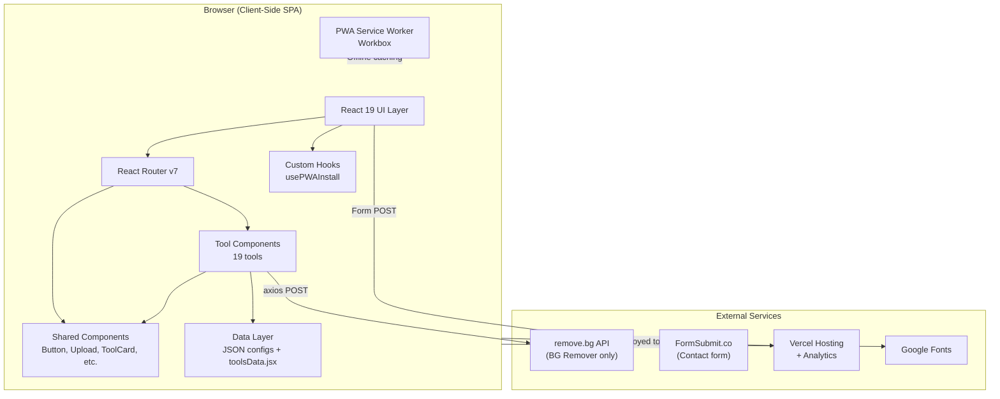
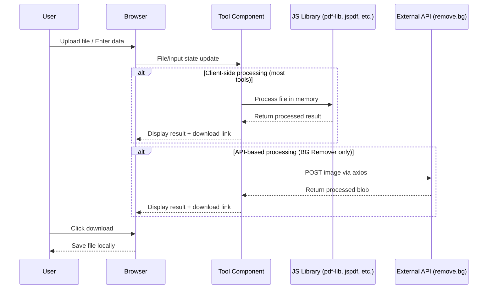

# Architecture

## System Architecture Diagram

## Data Flow

## Auth Flow

**There is no authentication in this project.** All tools are free and open to everyone. The only "auth" is the `VITE_REMOVE_BG_API_KEY` env variable used server-side for the remove.bg API calls.

## Folder Responsibility Map

| Folder | Responsibility |
|--------|---------------|
| `/src/App.jsx` | Root component, route definitions, lazy loading |
| `/src/main.jsx` | React entry point, BrowserRouter setup |
| `/src/Home/` | Landing page with search, category filters, tool grid |
| `/src/Tools/` | All 19 tool implementations (each has `.jsx` + `.css`) |
| `/src/components/` | Reusable UI components (Navbar, Footer, Button, etc.) |
| `/src/components/Common/` | Shared primitives (Button, Upload, ToolCard, CustomSelect, Icons) |
| `/src/data/` | Tool catalog data (JSON configs + toolsData.jsx aggregator) |
| `/src/hooks/` | Custom React hooks (PWA install) |
| `/src/pages/` | Static/info pages (About, Contact, FAQ, Legal, etc.) |
| `/src/chatgpt-tools/` | ChatGPT Secret Codes feature (prompt library) |
| `/src/WitPin/` | WitPin browser extension landing page |
| `/src/assets/` | Static images/assets |
| `/public/` | Favicon, workers, sitemap, robots.txt, preview images |
| `/docs/` | This documentation |

## Build & Chunk Strategy

Vite's Rollup config uses `manualChunks` to split vendor code:

| Chunk Name | Contents |
|-----------|----------|
| `vendor-core` | react, react-dom, react-router-dom, scheduler |
| `vendor-pdfjs` | pdfjs-dist |
| `vendor-jspdf` | jspdf |
| `vendor-pdflib` | pdf-lib |
| `vendor-media` | browser-image-compression, react-image-crop, jszip, gif.js, gifenc |
| `vendor-utils` | All other node_modules |

All tool pages are **lazy-loaded** via `React.lazy()` + `Suspense` for fast initial load.
